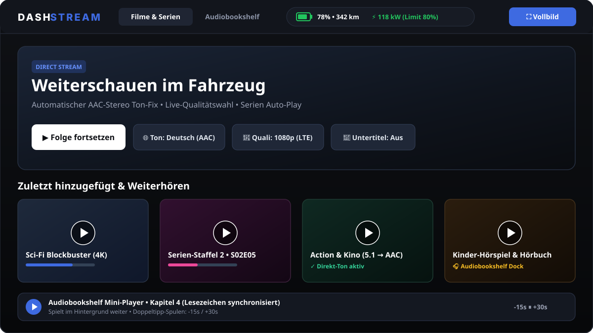

# 🚗 DashStream



Dein eigenes **Kino & Hörbuch-Studio direkt im Auto-Browser** – komplett kostenlos über deinen eigenen Heimserver mit **Jellyfin** und **Audiobookshelf**.

---

## 🤔 Was macht DashStream?
Der normale Jellyfin-Player ist im Browser auf dem Fahrzeug-Display oft fummelig: Die Knöpfe sind viel zu klein, Filme mit Kinoton (Dolby 5.1 / DTS) bleiben stumm und bei schwachem Mobilfunk ruckelt das Bild.

**DashStream** legt sich als schicke, dunkle Oberfläche direkt über dein Jellyfin:
* **Riesige Touch-Knöpfe** speziell für große Fahrzeug-Displays und Smartphones.
* **Automatischer Ton-Fix (AAC-Stereo):** Macht stumme Dolby-/DTS-Filme sofort hörbar, ohne dass dein Server das Video neu berechnen muss (1:1 Direct Stream).
* **Funkloch-Schutz (Qualitäts-Umschalter):** Schalte mitten im Film mit einem Tipp zwischen `Max`, `1080p`, `720p (LTE)` und `480p (Funkloch)` um.
* **Hörbücher & Kinder-Hörspiele:** Integriert **Audiobookshelf** direkt als eigenen Reiter plus Mini-Audio-Player.
* **Live-Ladebalken (optional mit TeslaMate):** Zeigt dir oben am Bildschirmrand live Akkustand (%), kW-Ladeleistung und die Restzeit am Schnelllader.

---

## 🛠️ Schritt 1: Installation auf deinem Server (Dauert 30 Sekunden)

Du brauchst nur einen Server (z. B. Mini-PC, Ubuntu-Server, Raspberry Pi oder NAS), auf dem **Jellyfin als Docker-Container** läuft. Logge dich per Terminal (SSH) auf deinem Server ein und kopiere diese 4 Zeilen hinein:

```bash
git clone https://github.com/bierzelt-kind/dashstream.git
cd dashstream
chmod +x install.sh
./install.sh
```

**Test zuhause im WLAN:**
Öffne deinen Browser und rufe diese Adresse auf (ersetze `192.168.1.100` durch die IP-Adresse deines Servers):

```text
http://192.168.1.100:8096/web/dashstream.html
```

Logge dich einmal mit deinem normalen Jellyfin-Namen und Passwort ein – fertig!

---

## 🌍 Schritt 2: Unterwegs direkt im Auto-Browser nutzen (mit Tailscale)

Damit du unterwegs am Ladepark oder auf Reisen auf deinen Server zuhause zugreifen kannst, solltest du **keine unsicheren Portfreigaben** in deinem Router (z. B. FritzBox) einrichten. Nutze stattdessen **Tailscale** (kostenlos) mit **Tailscale Funnel** – damit brauchst du **keine App und keinen Handy-Hotspot**, sondern tippst einfach deine Adresse direkt in den Browser im Auto ein.

1. **Tailscale auf dem Server installieren** (falls noch nicht vorhanden):
   ```bash
   curl -fsSL https://tailscale.com/install.sh | sh
   sudo tailscale up
   ```
2. **Im Tailscale-Konto einmalig HTTPS & Funnel aktivieren:**
   * Öffne im Browser [login.tailscale.com](https://login.tailscale.com), gehe auf **DNS** und klicke unten auf **Enable HTTPS**.
   * Gehe auf **Access Controls (ACLs)** und aktiviere `funnel` (oder folge dem Link, den dir Tailscale beim nächsten Befehl im Terminal anzeigt).
3. **Jellyfin (Port 8096) sicher für den Browser freigeben:**
   ```bash
   sudo tailscale funnel --bg 8096
   ```
   *(Optional für Audiobookshelf auf Port 13378 zusätzlich: `sudo tailscale funnel --bg --https=8443 13378`)*
4. **Direkt im Auto-Browser öffnen:**
   Tailscale gibt dir eine eigene `https://`-Adresse (z. B. `https://mein-server.tail1234.ts.net`). Öffne im Browser im Auto einfach:
   ```text
   https://mein-server.tail1234.ts.net/web/dashstream.html
   ```

---

## 🤖 Schritt 3: Telegram-Bot einrichten („dashstream an“ für 2 Stunden)

Damit dein Server nicht rund um die Uhr im Internet erreichbar sein muss, kannst du dir in 3 Minuten einen eigenen **Telegram-Bot** bauen.
Schreibst du dem Bot in Telegram **`dashstream an`**, schaltet der Server Tailscale/Funnel sofort ein und **nach 2 Stunden vollautomatisch wieder aus**!

### 1. Bot bei Telegram erstellen (auf dem Handy)
1. Öffne Telegram, suche nach **`@BotFather`** (mit dem blauen Haken) und tippe auf **Starten**.
2. Sende die Nachricht `/newbot`.
3. Tippe einen beliebigen Anzeigenamen ein (z. B. `Mein DashStream`).
4. Tippe einen Benutzernamen ein, der auf `bot` endet (z. B. `mein_dashstream_123_bot`).
5. Der `@BotFather` schickt dir jetzt deinen **HTTP API Token** (sieht z. B. so aus: `7123456789:AAHxyz...`). Kopiere dir diesen Token!

### 2. Sudo-Rechte für Tailscale ohne Passwort-Abfrage erlauben
Damit das Bot-Skript im Hintergrund `tailscale` ohne Passwort-Eingabe ein- und ausschalten darf, führe einmalig diesen Befehl im Server-Terminal aus:

```bash
echo "$USER ALL=(ALL) NOPASSWD: /usr/bin/tailscale" | sudo tee /etc/sudoers.d/tailscale-bot
sudo chmod 440 /etc/sudoers.d/tailscale-bot
```

### 3. Bot-Skript auf dem Server anlegen
Kopiere diesen Befehl ins Terminal, um das Skript `~/dashstream_bot.py` zu erstellen:

```bash
cat << 'EOF' > ~/dashstream_bot.py
import time
import subprocess
import urllib.request
import urllib.parse
import json

# HIER DEINEN TELEGRAM TOKEN VOM BOTFATHER EINTRAGEN:
TOKEN = "DEIN_TELEGRAM_BOT_TOKEN"

API_URL = f"https://api.telegram.org/bot{TOKEN}/"
timer_proc = None

def send_msg(chat_id, text):
    data = urllib.parse.urlencode({"chat_id": chat_id, "text": text}).encode("utf-8")
    try:
        urllib.request.urlopen(API_URL + "sendMessage", data=data, timeout=10)
    except Exception as e:
        print("Sende-Fehler:", e)

def get_updates(offset):
    url = API_URL + f"getUpdates?offset={offset}&timeout=30"
    try:
        with urllib.request.urlopen(url, timeout=35) as resp:
            return json.loads(resp.read().decode("utf-8")).get("result", [])
    except Exception:
        return []

print("DashStream Telegram-Bot laeuft...")
last_id = 0

while True:
    for upd in get_updates(last_id + 1):
        last_id = upd["update_id"]
        msg = upd.get("message", {})
        chat_id = msg.get("chat", {}).get("id")
        text = (msg.get("text") or "").strip().lower()
        if not chat_id or not text:
            continue

        if text in ["dashstream an", "/an", "/start"]:
            subprocess.run("sudo /usr/bin/tailscale up", shell=True)
            subprocess.run("sudo /usr/bin/tailscale funnel --bg 8096", shell=True)
            if timer_proc and timer_proc.poll() is None:
                timer_proc.terminate()
            timer_proc = subprocess.Popen(
                "sleep 7200 && sudo /usr/bin/tailscale funnel --https=443 off && sudo /usr/bin/tailscale down",
                shell=True
            )
            send_msg(chat_id, "✅ DashStream ist jetzt für 2 Stunden AN! Nach 2 Stunden schaltet sich Tailscale automatisch wieder aus.")

        elif text in ["dashstream aus", "/aus", "/stop"]:
            if timer_proc and timer_proc.poll() is None:
                timer_proc.terminate()
            subprocess.run("sudo /usr/bin/tailscale funnel --https=443 off", shell=True)
            subprocess.run("sudo /usr/bin/tailscale down", shell=True)
            send_msg(chat_id, "🛑 DashStream wurde sofort AUSgeschaltet.")

        elif text in ["dashstream status", "/status"]:
            res = subprocess.run("tailscale status", shell=True, capture_output=True, text=True)
            out = res.stdout.strip() or "Tailscale ist aktuell AUS."
            send_msg(chat_id, f"📊 Status:
{out[:400]}")

        else:
            send_msg(chat_id, "🤖 Befehle:
• dashstream an (aktiviert für 2 Std.)
• dashstream aus (sofort ausschalten)
• dashstream status")
    time.sleep(2)
EOF
```

Trage danach deinen echten Token vom BotFather mit diesem Befehl ein (ersetze `HIER_DEIN_TOKEN` durch deinen Token):

```bash
sed -i 's/DEIN_TELEGRAM_BOT_TOKEN/HIER_DEIN_TOKEN/' ~/dashstream_bot.py
```

### 4. Bot dauerhaft im Hintergrund starten (Autostart)
Damit der Bot immer automatisch im Hintergrund läuft (auch nach einem Server-Neustart), kopiere diesen Block ins Terminal:

```bash
sudo bash -c "cat << EOF > /etc/systemd/system/dashstream-bot.service
[Unit]
Description=DashStream Telegram Bot
After=network-online.target

[Service]
Type=simple
User=$USER
ExecStart=/usr/bin/python3 $HOME/dashstream_bot.py
Restart=always
RestartSec=5

[Install]
WantedBy=multi-user.target
EOF"

sudo systemctl daemon-reload
sudo systemctl enable --now dashstream-bot.service
```

**So nutzt du den Bot ab sofort in Telegram:**
* **`dashstream an`** $
ightarrow$ Schaltet Tailscale & Funnel sofort ein und startet den 2-Stunden-Countdown.
* **`dashstream aus`** $
ightarrow$ Schaltet Tailscale sofort wieder ab.
* **`dashstream status`** $
ightarrow$ Zeigt dir live, ob Tailscale gerade an oder aus ist.

---


---

## 🔋 Schritt 4: Live-Ladestatus & Akkustand einbinden (mit TeslaMate)

Damit oben in der Leiste von **DashStream** live dein **Akkustand (%)**, die **Reichweite (km)**, die **aktuelle Ladeleistung (kW)** und das **Ladelimit** angezeigt werden, nutzt DashStream die Daten von **[TeslaMate](https://docs.teslamate.org/)** (dem kostenlosen Open-Source-Logger auf deinem Heimserver).

### Wie funktioniert der Trick?
Der Browser im Auto darf aus Sicherheitsgründen (CORS) nicht direkt auf deine Datenbank zugreifen. Deshalb liest ein winziges Hintergrund-Skript auf deinem Server alle 10 Sekunden die aktuellen Fahrzeugdaten direkt aus deiner **TeslaMate-Datenbank** aus und legt sie als kleine Datei (`tesla_status.json`) in den Jellyfin-Ordner. DashStream liest diese Datei dann automatisch aus.

### 1. Voraussetzung prüfen
Auf deinem Server muss **TeslaMate** im Docker laufen. Prüfe kurz mit diesem Befehl, wie dein TeslaMate-Datenbank-Container heißt (meistens `teslamate-database-1` oder `db`):

    docker ps --format "{{.Names}}" | grep -iE "teslamate|db|postgres"

### 2. Das Live-Brücken-Skript anlegen
Erstelle auf deinem Server die Datei `~/dashstream_teslamate.sh`:

    cat << 'EOF' > ~/dashstream_teslamate.sh
    #!/bin/bash
    # Name deines TeslaMate-Datenbank-Containers & Jellyfin-Containers:
    DB_CONTAINER=$(docker ps --format '{{.Names}}' | grep -iE 'teslamate.*db|teslamate.*database|postgres' | head -n 1)
    JF_CONTAINER=$(docker ps --format '{{.Names}}' | grep -i 'jellyfin' | head -n 1)
    DB_USER="teslamate"
    DB_NAME="teslamate"

    echo "Starte DashStream Live-Ladestatus-Bruecke ($DB_CONTAINER -> $JF_CONTAINER)..."

    while true; do
      JSON=$(docker exec "$DB_CONTAINER" psql -U "$DB_USER" -d "$DB_NAME" -t -A -c "
        SELECT row_to_json(t) FROM (
          SELECT
            p.battery_level,
            ROUND(p.rated_battery_range_km) AS range_km,
            COALESCE(p.speed, 0) AS speed,
            COALESCE(c.charger_power, 0) AS charger_power,
            COALESCE(c.charge_limit_soc, 80) AS charge_limit_soc,
            COALESCE(c.time_to_full_charge, 0) AS time_to_full,
            (SELECT state FROM states WHERE car_id = 1 ORDER BY start_date DESC LIMIT 1) AS state
          FROM positions p
          LEFT JOIN charging_processes cp ON cp.car_id = p.car_id AND cp.end_date IS NULL
          LEFT JOIN charges c ON c.charging_process_id = cp.id
          WHERE p.car_id = 1
          ORDER BY p.date DESC
          LIMIT 1
        ) t;" 2>/dev/null)

      if [ -n "$JSON" ]; then
        echo "$JSON" > /tmp/tesla_status.json
        docker cp /tmp/tesla_status.json "$JF_CONTAINER":/usr/share/jellyfin/web/tesla_status.json 2>/dev/null
      fi
      sleep 10
    done
    EOF
    chmod +x ~/dashstream_teslamate.sh

### 3. Als automatischen Hintergrund-Dienst starten
Damit die Ladeanzeige immer von selbst mitläuft (auch nach einem Neustart des Servers), führe diesen Block einmalig im Terminal aus:

    sudo bash -c "cat << EOF > /etc/systemd/system/dashstream-teslamate.service
    [Unit]
    Description=DashStream TeslaMate Live Status Bridge
    After=docker.service
    Requires=docker.service

    [Service]
    Type=simple
    User=$USER
    ExecStart=/bin/bash $HOME/dashstream_teslamate.sh
    Restart=always
    RestartSec=10

    [Install]
    WantedBy=multi-user.target
    EOF"

    sudo systemctl daemon-reload
    sudo systemctl enable --now dashstream-teslamate.service

**Fertig!** Sobald dein Auto lädt oder fährt, siehst du oben in DashStream live deinen Akkustand, die kW-Ladeleistung am Supercharger und die Restladezeit.


---

## 🖥️ Schritt 5: Vollbild im Auto & Geheimfunktionen

* **Echtes Vollbild (während das Auto in „P“ parkt):**
  Tippe oben rechts im Dashboard auf den blauen Knopf **„Vollbild“**. Über den integrierten Weiterleitungs-Trick öffnet sich DashStream komplett ohne Browser-Leisten über den gesamten Bildschirm.
* **Doppel-Tipp zum Spulen:**
  Tippe im Video zweimal schnell auf die **linke Bildhälfte** (`-15 Sek.`) oder auf die **rechte Bildhälfte** (`+30 Sek.`).
* **Sprache & Qualität wechseln:**
  Oben im Player kannst du jederzeit mit **`🌐 Ton`** die Sprache (z. B. Deutsch/Englisch) und mit **`📶 Quali`** die Datenrate (`Max`, `1080p`, `720p`, `480p`) live umschalten.
* **🔓 Geheimer Beifahrer-Modus (Co-Pilot Override):**
  Standardmäßig schaltet sich das Videobild beim Losfahren ab 3 km/h dunkel (der Ton läuft weiter).
  * **Freischalten für den Beifahrer:** Tippe oben links **5-mal schnell hintereinander** auf das Logo, bis es rot leuchtet (`CO-PILOT UNLOCKED`).
  * **Panik-Knopf:** Ein einziger Tipp mitten auf das laufende Video während der Fahrt schließt das Video sofort und verriegelt den Modus wieder.

---

## ❓ Häufige Fragen (FAQ)

* **Nach einem Jellyfin-Docker-Update ist DashStream verschwunden (404 Not Found)?**
  Wenn du deinen Jellyfin-Container aktualisierst, setzt Docker den internen Web-Ordner zurück. Führe danach im Ordner `dashstream` einfach noch einmal kurz `./install.sh` aus – in 2 Sekunden ist alles wieder da.
* **Ich nutze kein TeslaMate oder kein Audiobookshelf – geht DashStream trotzdem?**
  Ja! Wenn keine `tesla_status.json` vorhanden ist, läuft DashStream ganz normal als reiner Mediaplayer für Jellyfin weiter.
* **Warum muss ich mich beim ersten Aufruf einloggen?**
  DashStream nutzt die offizielle Jellyfin-Anmeldung deines Servers. Du loggst dich beim allerersten Mal im Auto-Browser auf deiner normalen Jellyfin-Startseite ein (Haken bei „Angemeldet bleiben“ setzen) und rufst danach `/web/dashstream.html` auf.
