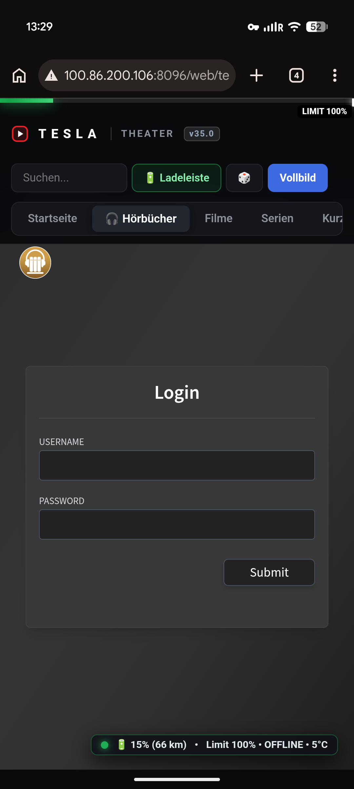
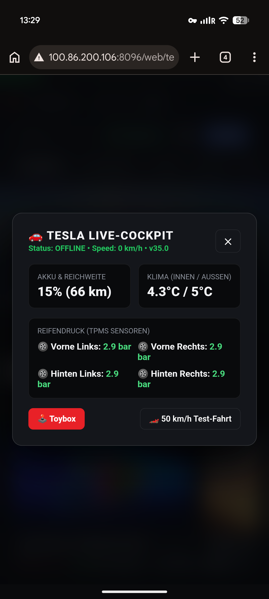

# ⚡ DashStream, TeslaMate & Usenet Automation Suite (v37.0)
**In-Car Media Gateway, Live Telemetry Cockpit, AI Telegram Sentinel & Full Usenet/*arr Media Stack**

**DashStream** ist das Rundum-Sorglos-Paket für Tesla-Fahrer mit eigenem Home-Server. Es verbindet ein speziell für den Tesla-Browser optimiertes **Jellyfin & Audiobookshelf Web-Frontend** mit **Echtzeit-Fahrzeugtelemetrie aus TeslaMate**, einem sprachgesteuerten **Telegram-Wächter-Bot** und einer vollautomatischen **Usenet-Medienstraße (`SABnzbd`, `Prowlarr`, `Radarr`, `Sonarr`, `Jellyseerr`)**.

---

## 📸 DashStream im Praxistest (Tesla In-Car UI)

| Login & Mediathek | Live-Cockpit & Reifendruck | Tesla Theater & Ladeleiste |
| :---: | :---: | :---: |
|  |  |  |

---

## 📦 Was ist alles enthalten?

* **`dashstream/dashstream.html`** — Zero-Dependency Single-File Web-UI für Jellyfin & Audiobookshelf im Tesla (mit Live-Akku-Leiste, Lade-Prognose am Film-Ende, Kinder-Touch-Sperre & Secret Toybox).
* **`bridge/bridge.py`** — Liest Fahrzeugdaten passiv aus TeslaMate (`MQTT` + `PostgreSQL`) ohne das Auto aufzuwecken (Zero-Wakeup-Garantie).
* **`telegram-bot/bot.py`** — Smarter Telegram-Bot mit Inline-Buttons, Sprachsteuerung, K.I.T.T.-Sprachausgabe, GPS-Wächter, `/wunsch`-Integration & 24h-Vampire-Drain-Analyse (`/drain`).
* **`docker-compose.full.yml`** — Komplett-Stack für Neueinsteiger (TeslaMate + PostgreSQL + Grafana + MQTT + Jellyfin + Audiobookshelf + SABnzbd + Prowlarr + Radarr + Sonarr + Jellyseerr).
* **`docker-compose.usenet.yml`** — Reiner Usenet- & *arr-Stack mit optimiertem `/data`-Hardlink-Mapping zum Nachrüsten.
* **`scripts/backup_all.sh`** — Automatisches Voll-Backup für Datenbanken und alle Docker-Configs.
* **`install.sh`** — Interaktiver **3-Modi-Installer** für Anfänger und Fortgeschrittene.

---

## 🚀 Schnell-Installation (Interaktiver 3-Modi-Installer)

Öffne dein Terminal auf einem frischen oder bestehenden Linux-Server (Ubuntu / Debian / Raspberry Pi) und starte den Assistenten:

    git clone https://github.com/bierzelt-kind/dashstream.git
    cd dashstream
    sudo ./install.sh

**Du kannst im Installer direkt auswählen:**
1. **Modus [1] Komplett-Server Neuinstallation (From Scratch):** Installiert Docker, generiert sichere Zufalls-Passwörter und startet **alle 12 Container** (TeslaMate + Streaming + Usenet/*arr-Stack) fix und fertig vorkonfiguriert.
2. **Modus [2] Nur Usenet & *arr-Stack nachrüsten:** Installiert `SABnzbd`, `Prowlarr`, `Radarr`, `Sonarr` und `Jellyseerr` mit sauberer Ordnerstruktur (`/data/usenet` und `/data/media`).
3. **Modus [3] Nur DashStream & Bot anbinden:** Klinkt das Tesla-UI und den Telegram-Bot in deine bereits vorhandenen Container ein.

---

## 📥 Usenet & *arr Automation — Übersicht & Einrichtung

Wenn du Modus `[1]` oder `[2]` nutzt, werden alle Medien- und Usenet-Dienste mit einer **einheitlichen `/data`-Ordnerstruktur (Atomic Moves / Hardlinks)** angelegt. Dadurch werden fertige Downloads in Sekundenbruchteilen nach Jellyfin verschoben, ohne doppelten Speicherplatz zu belegen:

* **🎬 DashStream (Tesla UI):** `http://DEINE-IP:8096/web/tesla.html`
* **🎧 Audiobookshelf (Hörbücher):** `http://DEINE-IP:13378`
* **🍿 Jellyseerr (Wunsch-Oberfläche):** `http://DEINE-IP:5055`
* **📥 SABnzbd (Usenet-Downloader):** `http://DEINE-IP:8080`
* **🔎 Prowlarr (Zentraler Indexer-Manager):** `http://DEINE-IP:9696`
* **🎥 Radarr (Automatische Filme):** `http://DEINE-IP:7878`
* **📺 Sonarr (Automatische Serien):** `http://DEINE-IP:8989`
* **⚡ TeslaMate & Grafana:** `http://DEINE-IP:4000` & `http://DEINE-IP:3000`

### Kurzanleitung für neue Nutzer (In 5 Minuten zur vollautomatischen Medien-Pipeline):
1. **SABnzbd (`:8080`):** Trage unter *Servers* deinen Usenet-Provider (z. B. Eweka, Newshosting) ein. Setze unter *Folders* den Temporary Download Folder auf `/data/usenet/incomplete` und den Completed Download Folder auf `/data/usenet/complete`.
2. **Prowlarr (`:9696`):** Füge deine Usenet-Indexer (NZBGeek, NzbPlanet, SceneNZBs etc.) hinzu. Verbinde Prowlarr unter *Settings -> Apps* mit `http://radarr:7878` und `http://sonarr:8989` (API-Keys aus Radarr/Sonarr kopieren) — Prowlarr synchronisiert dann alle Indexer automatisch!
3. **Radarr (`:7878`) & Sonarr (`:8989`):**
   * Wähle unter *Media Management -> Add Root Folder* bei Radarr `/data/media/movies` und bei Sonarr `/data/media/tv`.
   * Füge unter *Settings -> Download Clients* **SABnzbd** über die interne Docker-Adresse `Host: sabnzbd`, `Port: 8080` und dem SABnzbd-API-Key hinzu.
4. **Jellyseerr (`:5055`):** Melde dich mit deinem Jellyfin-Account an, verbinde Radarr & Sonarr — ab sofort kannst du (oder deine Familie) auf dem Handy oder über den Telegram-Befehl **`/wunsch [Filmtitel]`** jeden Film mit einem Klick anfordern, und er landet wenige Minuten später automatisch im Tesla!

---

## ✨ Highlights im Auto & auf Telegram (v37.0)

* **🔋 Live-Akku-Prognose am Film-Ende:** Zeigt im Videoplayer live an, mit wie viel Prozent Akku du am Ende der Folge aussteigst (berechnet gegen aktuelle Supercharger-`kW` oder Standverbrauch).
* **📲 Instant Exit Handoff Sync:** Sobald du auf `P` schaltest oder die Fahrertür öffnest, wird die exakte Sekunde an Jellyfin gepusht, damit du auf dem Smartphone nahtlos weiterschauen/-hören kannst.
* **🔒 Kinder-Schloss (Touch-Lock), 🌙 Sleep-Timer & ⏭️ Auto-Next-Episode:** Perfekt für Kinder auf der Rückbank oder lange Ladepausen.
* **🤖 Intelligenter Telegram-Bot:** Steuere deinen Server per **Sprachnachricht**, **Freitext** oder über das **Inline-Button-Cockpit**:
  * **`/drain`** — 24h Stromverlust-, Watt- & Tiefschlaf-Analyse (erkennt sofort aktiven Wächtermodus).
  * **`/tesla`** & **`/wo`** — Komplettes Fahrzeug-Cockpit & passiver GPS-Standort-Pin.
  * **`/neu`** & **`/wunsch [Titel]`** — Zeigt die 5 neuesten Usenet-Downloads auf Jellyfin oder startet eine Anfrage in Jellyseerr.
  * **`/jfon`** / **`/jfoff`** — Öffnet den sicheren Tailscale-Streaming-Tunnel für 2 Stunden.
  * **`/backup`** — Erstellt ein Komplett-Backup aller Datenbanken und Docker-Konfigurationen.
